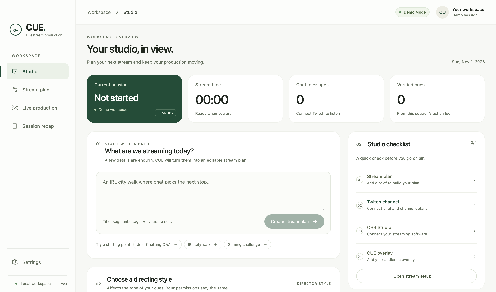

# CUE

**Your stream. Right on cue.** A local desktop livestream producer built with Electron, React, TypeScript and SQLite.

Describe your show, edit a plan, connect your studio, approve going live, and let a bounded director turn repeated chat topics into verified OBS overlay cues. The decision feed records observations, evidence, execution and verification. Finish with a persisted recap and Markdown/JSON exports.



## Run

Requires Node.js **24+** and npm. Package installation needs internet access, including Electron's platform download.

```sh
npm install
npm run dev
```

CUE starts in **Demo Mode**, without Twitch credentials, OBS, model credentials, or network requests. Its transparent overlay server binds locally to `127.0.0.1:4318`. Even Demo Mode needs permission to open that local port.

```sh
npm test
npm run check
npm run build
npm start
```

`npm run dev:web` previews the renderer only; production operations require Electron's preload bridge. It does not provide a standalone web app.

## Two-minute demo

1. Describe an interactive city walk and choose a director mode.
2. Edit the plan. **Connect Twitch** and **Connect OBS** use simulated adapters in Demo Mode.
3. **Apply to Twitch** previews the metadata. **Stage in OBS** stages the simulated source; the real local overlay feed is running.
4. Run readiness, choose **Go live**, and approve both the app preview and native confirmation. Demo Mode never starts a public stream.
5. Open Live Production and **Inject chat spike**. Three repeated challenge messages trigger a contextual overlay. Inspect the evidence IDs, reasoning and verification result.
6. **Pause Director**, inject more chat, and see that no additional cue executes. There is a default 60-second cooldown, adjustable between 10 and 600 seconds.
7. Confirm **End stream** and export your recap.

## Real production

Copy `.env.example` to `.env` and set `TWITCH_CLIENT_ID` to your own **public** Twitch application's client ID. No client secret is distributed. Register a public client with device authorization support in the Twitch Developer Console. Switch off Demo Mode in Settings and reconnect both services.

On macOS, build and install the native app with:

```sh
npm run install:mac
```

The installer puts CUE in `~/Applications/CUE.app`, backs up an existing copy, and copies only CUE runtime configuration to a private `config.env` in the app's user-data directory. Credentials stay outside the app bundle. You can then launch CUE directly from Finder without Terminal. The installer preserves the existing `Electron` user-data directory when migrating a prior installation.

Connections are **session-only by default**, so startup does not access macOS Keychain. To save OAuth and OBS credentials between launches, explicitly enable **Remember connections on this Mac** in Settings. macOS may ask for your Mac login/Keychain password. With remembering enabled and access allowed, CUE can reconnect OBS and update the overlay URL after restart; it never starts broadcasting automatically. With it off, reconnect the services after closing CUE. An OpenAI API key in the private runtime configuration still loads normally.

Settings displays whether your Twitch client and optional AI planner are configured. `CUE_CONFIG_PATH` can select a different runtime configuration file. Development runs also read the checkout's `.env`; packaged apps read the private user-data configuration, independent of their working directory.

- Twitch opens the official device authorization page in your browser. Enter the public code displayed in CUE. It requests `user:read:chat` and `channel:manage:broadcast`, validates the user identity, and subscribes to your channel's EventSub chat. See [Twitch setup](packages/twitch/README.md).
- Enable **Tools → WebSocket Server Settings** in OBS Studio 28+; enter the local host, port (usually 4455), and password in Settings. Staging creates/reuses **CUE Overlay** in the current scene. Configure your OBS stream destination yourself. See [OBS setup](packages/obs/README.md).
- **Go live starts OBS broadcasting to its configured destination.** It always requires a native confirmation. OBS connectivity and actual broadcasting are displayed separately. Quitting CUE does not stop OBS.
- Set `CUE_OVERLAY_PORT` to another available local port if necessary. The browser-source URL contains a local read token; restage after restarting CUE. See [overlay protocol](packages/overlay/README.md).
- Optionally set `OPENAI_API_KEY` and `OPENAI_MODEL` in `.env` for structured plan generation in real mode. Only the creative brief and director mode are sent to the provider. Demo Mode uses the local planner. Provider failures fall back to an editable local plan. The director trigger loop remains deterministic and bounded.

Metadata is applied only after the app's explicit preview/approval. Category names resolve to exact Twitch matches; use a valid numeric category ID or edit the category if no match exists. Real Twitch polls, automated scene switching, frame sampling, transcription, and public posting are deferred; no UI pretends to execute them.

## State and security

Electron's main process owns adapters, credentials, policy, SQLite and the overlay server. The sandboxed renderer gets a fixed typed bridge; it cannot send generic IPC or access Node. OAuth credentials stay in memory by default. Explicitly remembered connections use OS-backed Electron `safeStorage` encryption, including saved OBS passwords; startup does not access Keychain unless remembering was enabled. OBS passwords remain in main-process memory after connection unless the user explicitly opts into encrypted remembering. Model keys stay in environment configuration. Secrets are not placed in SQLite.

Session plans, events, decisions and results persist in `cue.sqlite` under Electron's application user-data directory. Restarting an active session restores its audit history with automation paused. Reconnect OBS, restage the overlay if needed, check actual broadcasting and explicitly resume. Remembered OBS connections can reconnect and restage automatically, with automation still paused. Delete history in Settings to remove local sessions and disconnect stored Twitch credentials. Environment configuration is managed separately.

See [security boundaries](docs/SECURITY.md), [typed API](docs/API.md), [demo rehearsal](docs/DEMO.md), and [implementation status](docs/IMPLEMENTATION.md).

## Development and commits

All project commits include `Co-authored-by: lukietee <lucasnotlukie@gmail.com>`.

The standard `.git` repository now contains the implementation history on `main`; use normal Git commands. `.cue-git` remains an ignored backup of the initial development history.

Enable the versioned commit hook in a new checkout to automatically add the required coauthor trailer:

```sh
git config core.hooksPath .githooks
```

The hook is already enabled in this workspace. GitHub CLI authentication is configured locally for `lukietee`.

The project remote is [lukietee/CUE](https://github.com/lukietee/CUE). Changes are developed on feature branches and submitted through pull requests. GitHub prohibits approving a PR with its author's account.

## Validation limits

The build and all 43 core/integration tests pass with installed dependencies, including the real local HTTP/WebSocket overlay check. `npm run test:desktop` also passes against a real Electron window and isolated Demo Mode profile, including confirmations, cue execution, pause, recap export, and desktop/compact/narrow screenshots. See [design and visual checks](docs/DESIGN.md).

Credentialed Twitch/OBS smoke testing is still required; no public broadcast or real-account authorization was performed as part of these checks.
