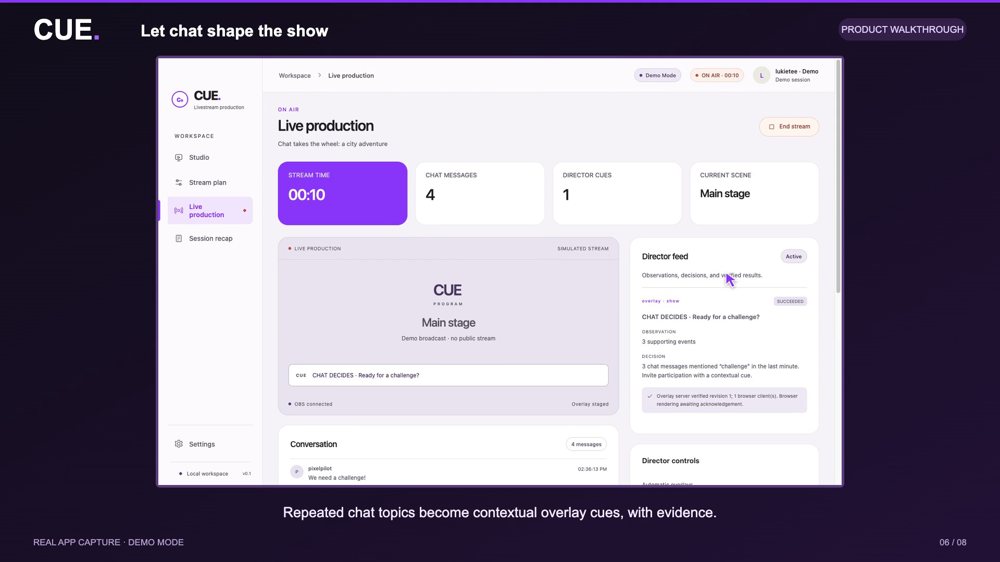

# CUE narrated product walkthrough

[Watch the finished 94-second demo](cue-demo.mp4) · [Subtitles](cue-demo.srt) · [Narration](narration.txt)



The walkthrough records the real Electron app: studio, brief entry, editable plan, Twitch/OBS demo connections, overlay staging, readiness, broadcast confirmation, chat-triggered cue, pause/resume, and recap export. An isolated Demo Mode profile exercises the application without accessing the user's session or starting a public broadcast. Demo Mode remains visible in the video.

Presentation adds a purple frame, chapter captions, an animated pointer, and short fades. The app itself supplies all UI and production state. The local overlay is loaded in a hidden browser window so it receives and acknowledges real overlay messages. Audio is synthesized through ElevenLabs with the Liam premade voice by default.

## Generate

Requires installed project dependencies, `ffmpeg`, and `ffprobe`. Add `ELEVENLABS_API_KEY` to the gitignored project `.env` file. Optionally set `ELEVENLABS_VOICE_ID` and `ELEVENLABS_MODEL`.

```sh
npm run build
node --import tsx scripts/create-demo-video.ts
```

The storyboard and narration are in [storyboard.json](storyboard.json). Audio is cached by text, voice, and model so unchanged chapters do not make additional speech requests. API calls consume the connected ElevenLabs account's credits.

Outputs are saved under the gitignored `release/demo/` directory:

- `cue-demo.mp4`: 1920 × 1080, 30 fps, H.264 video with loudness-normalized AAC narration, chapter markers, and optional English subtitles.
- `cue-demo.srt`: sentence-level subtitles, approximately timed from narration duration.
- `narration.txt`: spoken script.
- `session-recap.md`: recap exported by the captured app.
- Chapter PNGs and MP4s, narration audio, and capture manifests for review and re-editing.

Use `--silent` to produce a captioned preview without ElevenLabs requests. Use `--render-only` to reuse the last capture and narration after changing video framing. Retained source JPEG frames live in a disposable OS temporary directory referenced by `capture.json`; preserve that directory if you need to render again later.

No credentials are written to the storyboard, source files, logs, or rendered video.

Co-authored-by: lukietee <lucasnotlukie@gmail.com>
